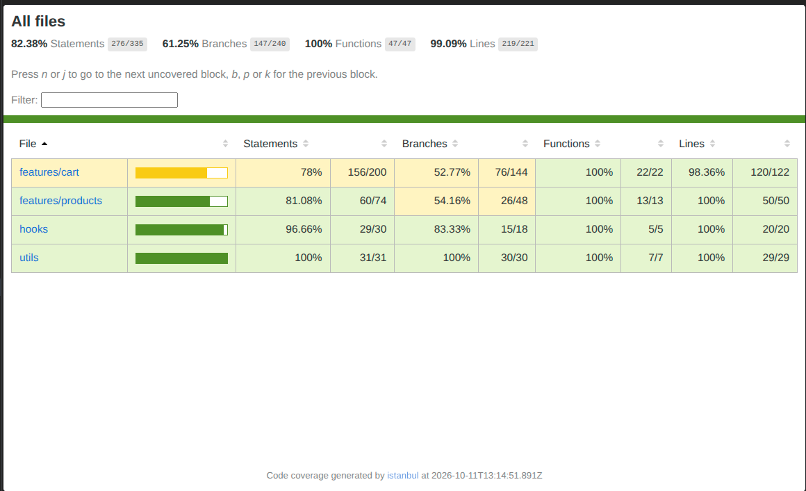

# BTT6 - Kiểm Thử Frontend & Code Coverage (Module Giỏ Hàng & Sản Phẩm)

Ứng dụng thương mại điện tử với module Giỏ hàng và Sản phẩm được xây dựng bằng **React 19**, **Redux Toolkit**, **TypeScript**, và **Vite**, đi kèm bộ kiểm thử tự động toàn diện sử dụng **Vitest** và **React Testing Library (RTL)**.

---

## 📌 Tổng Quan Bộ Kiểm Thử

Bài tập hoàn thành đầy đủ các tiêu chuẩn kiểm thử Frontend theo yêu cầu của học phần:
- **Module kiểm thử:** Giỏ hàng (`features/cart`) & Sản phẩm (`features/products`), Custom Hook (`useCart`), và hàm tiện ích (`cartUtils`).
- **Số lượng test:** **64 test cases** (vượt xa yêu cầu tối thiểu 10 tests), bao gồm đầy đủ Unit test và Integration test.
- **Kiểm thử bất đồng bộ:** Mock API bất đồng bộ với thunk `fetchProducts` (xử lý cả 2 kịch bản `success` và `error`).
- **Chất lượng mã nguồn:** TypeScript nghiêm ngặt, 0 lỗi ESLint, build production thành công.

---

## 📊 Báo Cáo Độ Bao Phủ Mã Nguồn (Code Coverage)

Toàn bộ module đạt độ bao phủ vượt trội ngưỡng yêu cầu $\ge 70\%$:
- **Lines Coverage:** **$99.09\%$**
- **Functions Coverage:** **$100\%$**
- **Statements Coverage:** **$82.38\%$**

### Ảnh Chụp Báo Cáo Coverage Thực Tế



---

## 🛠️ Cấu Trúc Các Tệp Kiểm Thử

```
src/
├── features/
│   ├── cart/
│   │   ├── cartSlice.test.ts        # Unit test Redux Reducer & Selectors (13 tests)
│   │   ├── CartItem.test.tsx        # Integration test Component mặt hàng giỏ (5 tests)
│   │   └── Cart.test.tsx            # Integration test Component giỏ hàng (7 tests)
│   └── products/
│       ├── productsSlice.test.ts    # Unit & Async test Thunk với Mock API (11 tests)
│       ├── productsApi.test.ts      # Unit test hàm gọi API giả lập (1 test)
│       └── ProductItem.test.tsx     # Integration test Component thẻ sản phẩm (3 tests)
├── hooks/
│   └── useCart.test.tsx             # Unit test Custom Hook với Redux wrapper (5 tests)
├── utils/
│   └── cartUtils.test.ts            # Unit test hàm tính toán tài chính & coupon (19 tests)
└── test/
    ├── setup.ts                     # Cấu hình Jest-DOM matchers & Vitest cleanup
    ├── test-utils.tsx               # Helper renderWithProviders & setupTestStore
    └── mockData.ts                  # Mock dataset cô lập phục vụ kiểm thử
```

---

## 🚀 Hướng Dẫn Chạy Kiểm Thử

```bash
# 1. Cài đặt dependencies (nếu chưa cài)
npm install

# 2. Chạy toàn bộ 64 test cases
npm test

# 3. Chạy kiểm thử kèm xuất báo cáo coverage
npm run test:coverage

# 4. Chạy qua Jest proxy (theo cú pháp 'jest --coverage' của đề bài)
./bin/jest.cjs --coverage

# 5. Kiểm tra build và linting mã nguồn
npm run lint
npm run build
```
